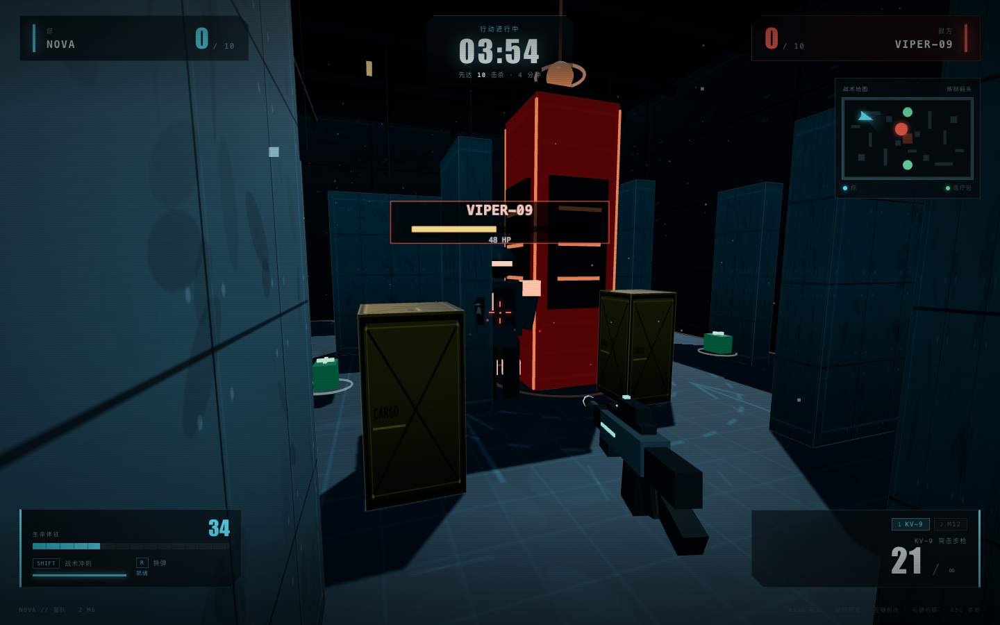
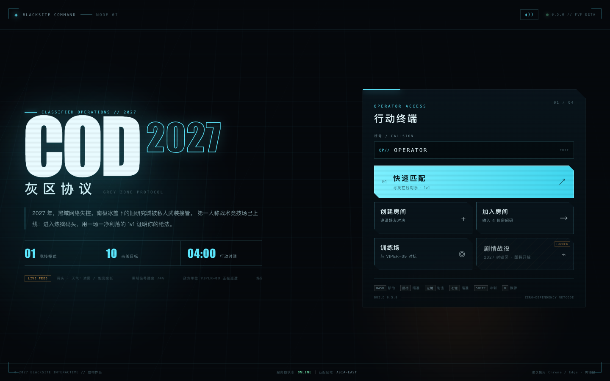
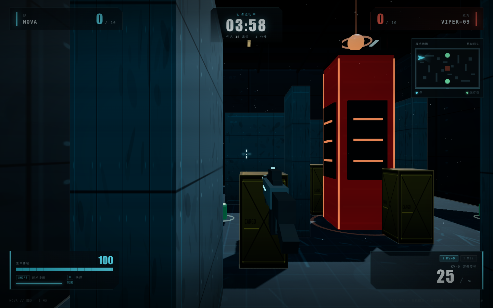
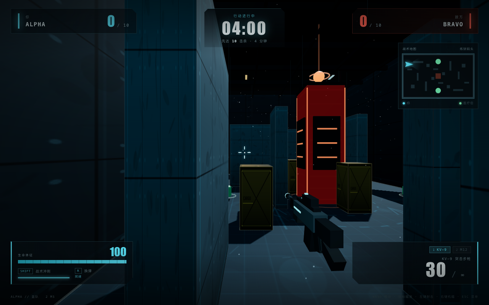
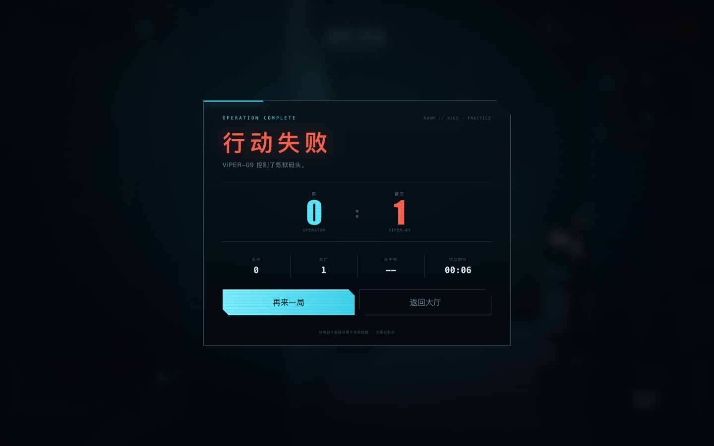
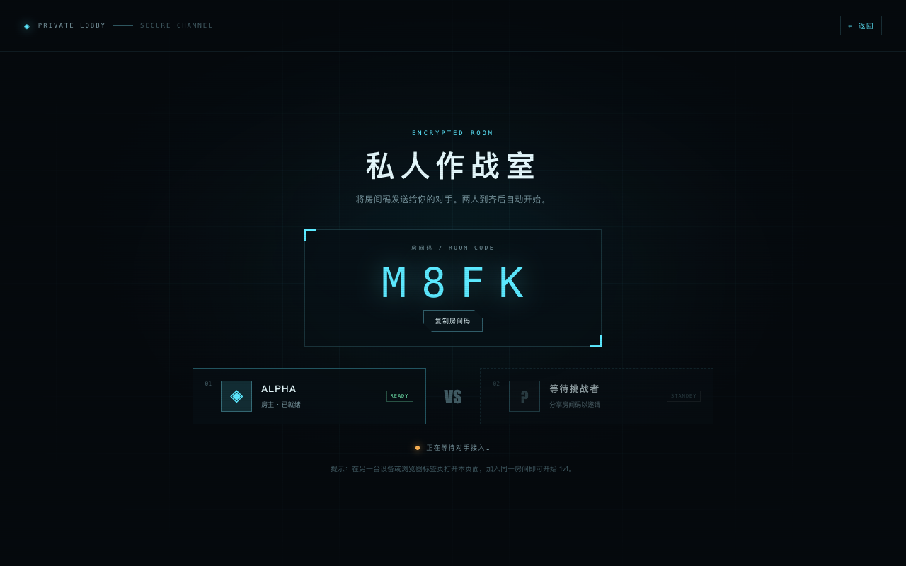
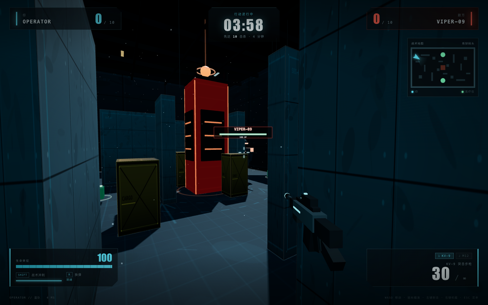

# COD 2027 // 灰区协议

[](https://github.com/Vist233/cod2027/actions/workflows/ci.yml)
[](LICENSE)

**一句命令，一个能联机的 3D 第一人称射击游戏。**

由 **dsfalsh 1017** 根据一条提示词生成第一版，再通过多轮对话迭代成现在可玩的
**3D 第一人称 · 服务端权威 · 1v1 战术射击 PvP**。

没有 Unity/Unreal 工程，没有外部美术资源，也没有前端构建步骤。地图、角色、武器、特效和
音效全部由代码程序化生成，浏览器打开就能玩。



<p align="center">
  <code>Node.js 18+</code> · <code>Three.js</code> · <code>WebSocket</code> · <code>零构建</code>
</p>

## 一句话起点

项目的全部起点，是下面这句话：

> 创建一个目录叫做cod2027，之后给我做个射击游戏，要有剧情的那种，线性剧情。你来先做pvp，我们后面加剧情

第一版完成后，又补了一句关键要求：

> 做一个3D的可以吗？不要这种，之后是这个也不能改变设计角度啊

于是它从俯视 2D 原型变成了第一人称 3D：服务端重新做 3D 射线命中，客户端换成 Three.js，
角色模型、武器、弹道、名牌、小地图和 ADS 都重新实现。

原始提示词、追加要求和迭代记录见 **[PROMPT.md](PROMPT.md)**。

## 现在能玩什么

- **3D 第一人称**：鼠标视角、WASD 移动、机瞄、后坐力、弹道、命中反馈
- **两种武器**：KV-9 突击步枪（全自动）和 M12 战术霰弹枪（7 弹丸）
- **完整对局**：10 杀或 4 分钟定胜负，阵亡后重新部署，支持重赛
- **三种入口**：快速匹配、4 位房间码私人房、单人训练场
- **战术要素**：冲刺、换弹、医疗包、爆头倍率、掩体与视线判断
- **AI 对手**：训练场机器人会用 A* 寻路绕墙、找掩体、捡医疗包
- **服务端权威**：60Hz 模拟、20Hz 快照；命中与移动由服务器判定
- **零构建前端**：Three.js 以静态 ES Module 加载，`npm start` 即用

## 截图

| 行动终端 | 机瞄 |
| --- | --- |
|  |  |

| 双人房间 | 结算 |
| --- | --- |
|  |  |

| 等待对手 | 敌人识别 |
| --- | --- |
|  |  |

## 快速开始

需要 **Node.js 18+**。

```bash
git clone https://github.com/Vist233/cod2027.git
cd cod2027
npm install
npm start
```

打开 **<http://localhost:2027>**。

- 换端口：`PORT=3000 npm start`；Windows PowerShell 用 `$env:PORT=3000; npm start`
- 调试模式：<http://localhost:2027/?debug=1>，控制台会暴露
  `window.__COD__ = { app, game, input }`

## 怎么玩

### 第一次进入

1. 输入呼号（默认 `OPERATOR`）。
2. 想先熟悉操作，点 **训练场**，对手是 AI `VIPER-09`。
3. 想真人对战，点 **快速匹配**；或 **创建房间** 把 4 位房间码发给朋友。
4. 进入对局后点击 **进入战场** 获取鼠标锁定。

> 浏览器需要允许指针锁定。按 `Esc` 会释放鼠标并打开暂停菜单，再点“进入战场”恢复。

### 模式

| 模式 | 人数 | 说明 |
| --- | --- | --- |
| 快速匹配 | 2 人 | 进入队列，凑齐两人自动开局 |
| 私人房间 | 2 人 | 创建 4 位房间码，朋友输入房间码加入；两人到齐自动开始 |
| 训练场 | 1 人 + AI | 与 `VIPER-09` 对战，用来熟悉地图和武器 |

**关于“多少人能打”：当前每局是 1v1。** 一台服务器可以同时承载多个房间/多场 1v1，
但还不是大逃杀或 MMO。快速匹配队列按先来后到配对，私人房间每间最多两人。

### 操作

| 输入 | 动作 |
| --- | --- |
| `W A S D` | 移动 |
| 鼠标移动 | 视角 |
| 鼠标左键 | 射击 |
| 鼠标右键 | 机瞄（ADS，降低扩散并拉近视角） |
| `R` | 换弹 |
| `1` / `2` | 切换 KV-9 / M12 |
| `Shift` | 战术冲刺（有冷却） |
| `Esc` | 暂停 / 释放鼠标 |

### 多端联机

一台设备运行 `npm start` 当服务器，其他设备用浏览器打开它的地址即可。**每局 1v1**；
同一台服务器可以开多个房间，让多组人同时打。

**同一 Wi-Fi（推荐）**

1. 房主运行 `npm start`，并保持终端不关。
2. 查房主局域网 IP：macOS `ipconfig getifaddr en0`，Windows `ipconfig`，Linux `hostname -I`。
3. 朋友打开 `http://<房主 IP>:2027`，例如 `http://192.168.1.23:2027`。
4. 房主创建房间 → 把 4 位房间码发给朋友 → 朋友加入 → 两人都点“进入战场”。

**不同网络**

- **Tailscale**（推荐给熟人）：所有人加入同一 tailnet，访问房主的 `http://100.x.y.z:2027`。
- **Cloudflare Tunnel**：`cloudflared tunnel --url http://localhost:2027`，把生成的 HTTPS 地址发朋友。
- **ngrok**：`ngrok http 2027`。
- 客户端会自动根据页面协议使用 `ws://` 或 `wss://`，不需要改代码。

**本机测试**：开两个浏览器窗口（其中一个用无痕模式），分别输入不同呼号，一个创建房间、
另一个输入房间码加入。

完整的 IP 查询、防火墙、公网隧道、多组同时开房和排障步骤见
**[docs/MULTIPLAYER.md](docs/MULTIPLAYER.md)**。

### 规则

- 先达到 **10 次击杀**，或 4 分钟结束时击杀数更高的一方获胜
- 阵亡后约 **2.6 秒**重新部署
- 地图上有两个医疗包，可恢复生命值
- 爆头伤害更高；移动和冲刺会增大扩散

## 技术实现

```text
浏览器（Three.js）                      Node.js 服务器
┌──────────────────────┐   WebSocket   ┌─────────────────────────┐
│ 输入 / 本地移动预测   │ ────────────> │ 60Hz 权威模拟            │
│ 第一人称相机 / 特效   │ <──────────── │ 20Hz 快照 + 事件         │
│ 远端插值 / HUD / 小地图│               │ 命中、碰撞、AI、房间管理 │
└──────────────────────┘               └─────────────────────────┘
```

- 服务端以 60Hz tick 计算移动、射击、命中、换弹、冲刺、重生和胜负
- 客户端发送 `{ t: 'input', mx, my, aim, pitch, ads, shoot }`，约 30Hz
- 动作单独发送：`{ t: 'action', a: 'reload' | 'dash' | 'weapon', v }`
- 服务端以 20Hz 广播快照；客户端对远端玩家做插值
- 世界坐标单位是**厘米**：地图 `1600 × 1000`，玩家半径 20、身高 180、视高 165

### 项目结构

```text
server.js                HTTP 静态服务 + WebSocket 权威服务器
shared/game-config.js    地图、玩家、武器、模式常量（厘米）
shared/physics.js        水平圆形碰撞、墙体/拾取物判定
shared/raycast3d.js      3D 射线、墙体/玩家命中、视线判定
shared/nav.js            A* 网格寻路（训练场 AI）
public/index.html        菜单、HUD、结算 DOM
public/css/style.css     暗色青/琥珀战术界面
public/js/main.js        事件绑定、HUD、网络事件、游戏循环
public/js/game3d.js      Three.js 场景、第一人称相机、敌人/特效/小地图
public/js/world3d.js     地图、材质、士兵与武器模型、名牌
public/js/net.js         WebSocket 客户端
public/js/input.js       键鼠输入与指针锁定
public/js/audio.js       WebAudio 程序化音效
public/vendor/           Three.js 静态文件
scripts/smoke.mjs        Playwright 浏览器冒烟测试
scripts/combat-test.mjs  两个 WebSocket 客户端的对战测试
docs/media/              README 截图
docs/MULTIPLAYER.md      多端/局域网/公网联机指南
```

## 测试

先启动服务器，再开一个终端：

```bash
npm run smoke        # 菜单 → 训练场 → 射击/机瞄/换枪 → 双人私人房间
npm run test:combat  # 两个 WS 客户端自动寻路、瞄准、射击
```

`smoke` 使用 Playwright 的 Chrome channel，截图写入 `screenshots/`。
默认连接 `http://localhost:2027`；换端口时可传 `BASE_URL=http://localhost:3000 npm run smoke`，
对战测试可传 `WS_URL=ws://localhost:3000/ws npm run test:combat`。

GitHub Actions 会在每次 push 到 `main` 和 PR 时执行语法检查与服务端对战测试。
如果本机没有 Chrome：

```bash
npx playwright install chrome
```

## 剧情战役

主菜单保留了 **“剧情战役 — 开发中”** 入口。按最初的需求，先把 PvP 做完整，
下一步再写线性战役：任务目标、过场、脚本事件和关卡推进。

当前版本 **不包含战役关卡**，不要把它当成已经完成的剧情游戏。

## 已知限制

- 只有一张地图、两种武器，暂无成长、皮肤、排位系统
- 每局 1v1，不是大逃杀；私人房依赖房间码，没有账号和好友系统
- 没有反作弊；服务端权威只能阻止客户端直接伪造命中与移动
- 公网联机需要自己准备隧道或端口映射，项目不内置中继服务器

## 更多文档

- **[docs/MULTIPLAYER.md](docs/MULTIPLAYER.md)**：多端联机、局域网、公网隧道与排障
- **[AGENTS.md](AGENTS.md)**：给 Agent / 开发者的运行、架构、协议与多人对战说明
- **[PROMPT.md](PROMPT.md)**：这个项目的原始提示词与迭代记录

## License

MIT © 2026 Vist233。见 [LICENSE](LICENSE)。

## 致谢

- [Three.js](https://threejs.org/) — 3D 渲染
- [ws](https://github.com/websockets/ws) — WebSocket 服务端
- [Playwright](https://playwright.dev/) — 浏览器冒烟测试
- **dsfalsh 1017** — 从一句话开始写出这个项目的第一版

---

如果这个“一句话游戏”让你觉得有意思，欢迎点个 Star，或者开 Issue 聊聊下一步的剧情和玩法。
