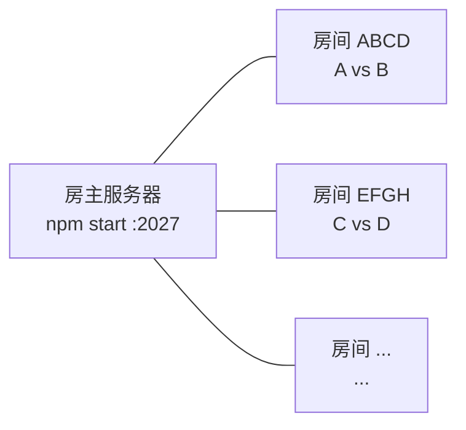

# 多端联机指南

COD 2027 的联机是**一台服务器 + 多台浏览器**：

- 一台设备运行 `npm start`，它就是“房主/服务器”。
- 其他电脑的浏览器打开房主的地址，就是“客户端”；手机/平板可以打开页面，但不能正常操作。
- 每个房间 **2 人 1v1**；同一台服务器可以开多个房间，让多组人同时打。
- 当前只支持键鼠 + 指针锁定，**手机/平板触屏不能正常游玩**；可以打开页面，但没有可用的操作方式。

> 先确认单机能玩：房主打开 `http://localhost:2027`，进训练场打一枪。
> 单机没问题，再往下做多端。

## 方案一：同一 Wi-Fi / 局域网（推荐）

适合家里、宿舍、办公室、线下聚会。延迟最低，不需要公网。

### 1. 房主启动服务器

```bash
cd cod2027
npm install
npm start
```

终端出现 `PvP server running at http://localhost:2027` 即成功。**这个终端不要关**，
关了服务器就停了。

### 2. 查房主的局域网 IP

**macOS**

```bash
ipconfig getifaddr en0
# 如果没输出，试 en1；或者：
ifconfig | grep "inet "
```

**Windows**

```powershell
ipconfig
```

找到当前 Wi-Fi/以太网适配器的 **IPv4 地址**，例如 `192.168.1.23`。

**Linux**

```bash
hostname -I
```

### 3. 其他设备打开地址

假设房主 IP 是 `192.168.1.23`，其他设备在浏览器打开：

```text
http://192.168.1.23:2027
```

注意：

- 必须用**房主的局域网 IP**，不能用 `localhost`。`localhost` 永远指向设备自己。
- 所有设备要在**同一个 Wi-Fi/局域网**。
- 如果改了端口，例如 `PORT=3000 npm start`，地址改成 `http://192.168.1.23:3000`。

先在客户端设备上执行（有 curl 的话）验证连通：

```bash
curl http://192.168.1.23:2027/
```

返回 HTML 就说明网络通了；打不开先看下面的“排障”。

### 4. 开始对局

两种方式任选：

**私人房间（推荐）**

1. 房主在菜单点 **创建房间**，拿到 4 位房间码，例如 `M7GP`。
2. 朋友在另一台设备点 **加入房间**，输入 `M7GP`。
3. 两人都点 **进入战场**，倒计时后开打。

**快速匹配**

1. 两人都点 **快速匹配**。
2. 服务器把队列里的两个人配成一场；先点的人会显示排队中。
3. 两人都进入战场后开始。

> 只有两个人时，私人房间更稳；快速匹配如果第三个人也在排队，会配给下一个等待者。

### 5. 多组人同时玩

一台服务器可以同时开多个 1v1 房间。例如 10 台设备连同一台房主服务器：



- 第 1 组：A 创建房间 `ABCD`，B 加入；
- 第 2 组：C 创建房间 `EFGH`，D 加入；
- 最多可以同时进行 5 场 1v1（10 台设备）。

每组只会在自己的房间里对战，互不干扰。当前**没有 3 人以上混战、观战或自动锦标赛**。

## 方案二：公网临时联机（不同网络）

不在同一个 Wi-Fi 时，需要把房主的 `2027` 端口暴露到公网。下面几种方式按推荐程度排列。

### A. Tailscale（最安全，适合熟人）

1. 房主和所有玩家安装 [Tailscale](https://tailscale.com/)，登录同一个 tailnet。
2. 房主照常 `npm start`。
3. 在 Tailscale 后台查看房主设备的 `100.x.y.z` 地址。
4. 其他人打开 `http://100.x.y.z:2027`。

流量走 Tailscale 私有网络，不需要端口映射，也不会把游戏暴露给陌生人。

### B. Cloudflare Tunnel（最省事，临时公开地址）

适合快速给朋友一个 HTTPS 链接。需要安装 `cloudflared`：

```bash
# macOS
brew install cloudflared
# Windows（PowerShell）
winget install --id Cloudflare.cloudflared
```

房主保持 `npm start`，另开一个终端：

```bash
cloudflared tunnel --url http://localhost:2027
```

终端会输出一个 `https://xxxx.trycloudflare.com` 地址。把这个地址发给朋友，直接打开即可。
页面是 HTTPS，客户端会自动使用 `wss://` 连接 WebSocket，不需要改代码。

注意：

- Quick Tunnel 是**临时公开地址**，关掉命令就失效，重启后地址会变。
- 任何拿到链接的人都能打开游戏；房间码只有 4 位，不是安全边界。
- 玩完就 `Ctrl+C` 关掉 tunnel，不要长期暴露。

### C. ngrok

```bash
ngrok http 2027
```

把输出的 `https://...ngrok-free.app` 地址发给朋友。同样自动使用 `wss://`。

### D. 路由器端口映射（不推荐新手）

1. 在路由器里把 TCP `2027` 映射到房主电脑的局域网 IP。
2. 查公网 IP，朋友访问 `http://<公网IP>:2027`。

限制：

- 很多宽带是 CGNAT，没有可用的公网 IPv4，端口映射不会生效。
- 家庭公网 IP 可能变化。
- 直接把未加认证的游戏暴露到公网有风险；只建议临时使用。
- 没有 HTTPS 时用 `ws://`，部分公司/校园网络会拦截非标准 WebSocket。

## 同一台电脑测试双人

没有第二台设备时：

1. 开两个浏览器窗口，其中一个用**无痕模式**（避免 localStorage 呼号串在一起）。
2. 两个窗口都打开 `http://localhost:2027`。
3. 分别输入不同呼号。
4. 一个创建房间，另一个输入房间码加入。
5. 两个窗口都点“进入战场”。

无痕窗口和普通窗口会被服务器当成两个独立客户端；同一窗口开两个标签页也可以，但鼠标锁定
会互相抢，建议用两个窗口。

## 排障

| 现象 | 检查 |
| --- | --- |
| 朋友打不开页面 | 是否用了房主 IP 而不是 `localhost`；是否同一 Wi-Fi；房主终端是否还在运行 |
| 同一 Wi-Fi 也打不开，但房主自己能玩 | 路由器可能开了 AP/客户端隔离，或两台设备不在同一网段；换手机热点或 Tailscale 验证 |
| 页面能开，但一直“网络连接失败” | 代理/防火墙是否拦截 WebSocket；用 `curl http://房主IP:2027/` 先确认 HTTP 通 |
| 公司/校园网能开网页但连不上 | 网络可能禁用非标准端口或 WebSocket；换手机热点/Tailscale 测试 |
| 找不到房间 | 房间码是否输错；房主是否已经退出；服务器是否重启过（重启后房间清空） |
| 鼠标不能转视角 | 点一下“进入战场”；使用 Chrome/Edge；确认浏览器允许指针锁定 |
| 延迟很高 | 尽量同一 Wi-Fi/有线；公网方案优先 Tailscale；避开跨运营商高峰 |
| 页面是旧版本 | `Cmd/Ctrl + Shift + R` 强制刷新；服务器静态文件设置了 `no-cache` |
| 端口被占用 | 房主执行 `lsof -nP -iTCP:2027 -sTCP:LISTEN`，换端口 `PORT=3000 npm start` |

### 防火墙

- **macOS**：第一次运行 Node 监听端口时，系统会弹“是否允许传入连接”，选允许。
- **Windows**：允许 Node.js 通过“专用网络”；公共网络默认可能拦截。
- **Linux**：确认 `ufw`/`firewalld` 放行对应 TCP 端口。

### 检查服务器是否在监听

```bash
lsof -nP -iTCP:2027 -sTCP:LISTEN
```

应该能看到 `node`。没有输出就说明服务器没启动，或启动在了别的端口。

## 安全提醒

- 项目没有账号、登录、反作弊和房间密码；4 位房间码只是方便分组，不是安全措施。
- 不要把 `npm start` 的服务长期暴露在公网。
- 公开演示建议用 Tailscale，或临时 Cloudflare Tunnel，用完立即关闭。
- 如果要做正式联机服务，需要补充：账号/鉴权、房间密码、速率限制、反作弊、TLS 终止和监控。

## 当前联机边界

- 每局 **1v1**，两个人。
- 一台服务器可并行多个房间，但每个房间独立计分。
- 没有跨服务器匹配；朋友必须连到**同一台**房主服务器。
- 没有观战、回放、语音。
- 手机/平板只能打开页面，不能正常操作；请用带键盘鼠标的电脑。
